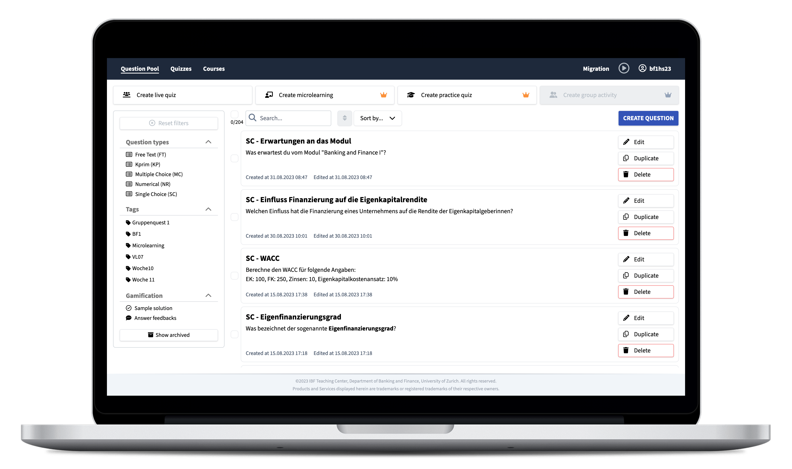

> Please note that this is the repository branch for KlickerUZH v3.0 released in August 2023. If you would like to have more information on the new concept of v3.0, have a look at our [public discussion](https://community.klicker.uzh.ch/t/klickeruzh-v3-0-concept-and-request-for-feedback/79).
>
> Please navigate to the [dev branch](https://github.com/uzh-bf/klicker-uzh/tree/dev) for the older [KlickerUZH v2.0](https://app.klicker.uzh.ch/), which is not publically available anymore.

`klicker-uzh` is the code repository of the [KlickerUZH](https://www.klicker.uzh.ch/) open-source audience interaction platform. KlickerUZH is developed by the Teaching Center of the Department of Finance at the University of Zurich, Switzerland.

KlickerUZH uses several applications and services:

- [Frontend PWA](apps/frontend-pwa) is the student interface for live quizzes, practice, microlearnings and course activities
- [Frontend Manage](apps/frontend-manage) provides lecturer content, course and activity management
- [Frontend Control](apps/frontend-control) is the optional mobile live-quiz controller
- [Authentication](apps/auth) provides lecturer delegated login and optional Edu-ID authentication
- [Backend](apps/backend-docker) serves GraphQL, authorization and real-time subscriptions
- [Response API](apps/response-api) accepts live-quiz responses for asynchronous processing
- [Response worker](apps/hatchet-worker-response-processor) and [general worker](apps/hatchet-worker-general) execute Hatchet workflows
- PostgreSQL, Redis, Hatchet, media storage and email provide the supporting infrastructure

Start with the [self-hosting overview](apps/docs/docs/self-hosting/overview.md) for the architecture, required and optional components, and current deployment limitations. The [documentation website](apps/docs) and [deployment artifacts](deploy) are also part of this repository.

To share code more easily between different services, we added new packages to the [Package Directory](https://github.com/uzh-bf/klicker-uzh/tree/v3/packages) with the following components:

- [Prisma](https://github.com/uzh-bf/klicker-uzh/tree/v3/packages/prisma): The prisma package contains the SQL database schema as well as migration scripts between different minor versions of KlickerUZH.
- [GraphQL](https://github.com/uzh-bf/klicker-uzh/tree/v3/packages/graphql): The GraphQL package contains the complete GraphQL schema and all resolvers for the KlickerUZH backend, as well as all business logic for provided services. For consistent typing, Pothos GraphQL and an auto-generated schema are used.
- [Grading](https://github.com/uzh-bf/klicker-uzh/tree/v3/packages/grading): The grading package provides the grading logic that is used to assign scores and experience points to participants and groups in gamified live quizzes, practice quizzes, microlearnings and other KlickerUZH elements.
- [LTI](https://github.com/uzh-bf/klicker-uzh/tree/v3/packages/lti): The LTI package contains logic to offer automatic sign ins for students through the Learning Tools Interoperability "LTI" standard (for OpenOLAT and Moodle integration).
- [Internationalization](https://github.com/uzh-bf/klicker-uzh/tree/v3/packages/i18n): The i18n package provides internationalized messages for all KlickerUZH services.
- [Shared Components](https://github.com/uzh-bf/klicker-uzh/tree/v3/packages/shared-components): The `shared-components` package is configured as an internal turborepo package, mainly providing the possibility to share React components between the frontends and reduce code duplication.
- [Markdown](https://github.com/uzh-bf/klicker-uzh/tree/v3/packages/markdown): The markdown package exports a React component to render markdown strings into formatted elements.

For more code commonality between different projects at the Teaching Center and the Department of Finance more generally, we also use a [Design System Package](https://github.com/uzh-bf/design-system) with commonly used, pre-styled and theme-based components.

## Roadmap / Issues

The KlickerUZH project is publicly managed and documented in this repository. A corresponding roadmap of our current developments can be found on our [Homepage](https://www.klicker.uzh.ch/development). Please feel free to share ideas, positive experiences, or problems on our [feedback platform](https://klicker-uzh.feedback.df-app.ch/) or start a new discussion in our [Community](https://community.klicker.uzh.ch/).

## Important Links

The following resources might be of special interest to you:

- [User Documentation](https://www.klicker.uzh.ch/getting_started/welcome)
- [Self-hosting Guide](apps/docs/docs/self-hosting/overview.md)
- [Engineering Wiki](docs/) (agent-facing, for working on this codebase)
- [Frequently Asked Questions](https://www.klicker.uzh.ch/faq)
- [Community and Discussions](https://community.klicker.uzh.ch/)
- [Roadmap](https://www.klicker.uzh.ch/development)

## Deployment

See the [self-hosting guide](apps/docs/docs/self-hosting/overview.md):

- [Local evaluation](apps/docs/docs/self-hosting/evaluation.md): a self-contained devcontainer with synthetic data, local mail and Blob emulation
- [Production deployment](apps/docs/docs/self-hosting/production.md): infrastructure, domain-specific builds, configuration, migrations and bootstrap gaps
- [Operations](apps/docs/docs/self-hosting/operations.md): acceptance checks, backups, upgrades, security and troubleshooting

The evaluation stack is not a production installer. A retained deployment still requires operator-managed infrastructure and first-account/reference-data provisioning. `deploy/compose` and the v2 chart are legacy artifacts; their S3/MinIO settings do not configure current v3 media storage.

## Contributing

We welcome any contributions to the KlickerUZH project. Before considering any contribution, we recommend that you create a discussion to discuss your proposed addition with the project maintainers and other contributors. Please also make sure to follow our [Contributing Guidelines](https://www.klicker.uzh.ch/v2/contributing/contributing_guidelines/), as your PR might need amendments otherwise.

## License

The KlickerUZH and all of its subprojects are licensed under the [AGPLv3](https://www.gnu.org/licenses/agpl-3.0.de.html).

