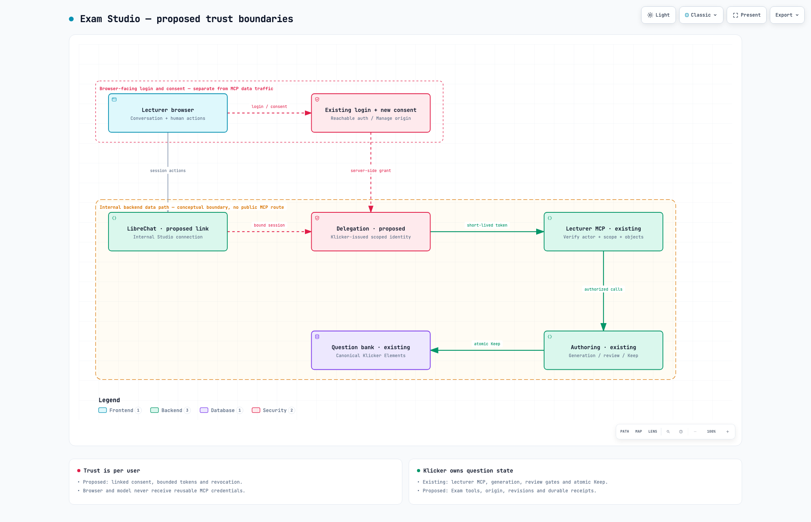
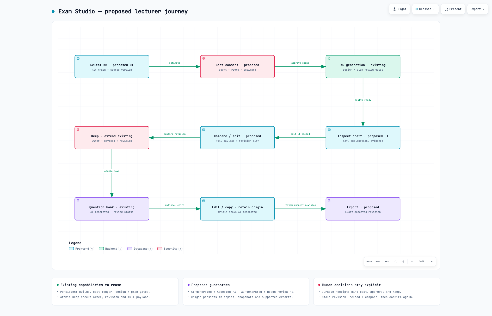

# Internal LibreChat Exam Studio integration plan

**Status:** proposed; documentation-only draft PR  
**Date:** 2026-10-18  
**Code baseline:** `v3-ai` at `7a8e86d3b7f9249ad4539028d0d40a85136cf801`  
**Delivery boundary:** lecturer authoring and review; no implementation,
deployment, credential, access-policy, or production-data changes in this PR

## Visual walkthrough

[Architecture and lecturer journey](./librechat-exam-studio-visuals/README.md)
include full-size PNGs, interactive HTML downloads, editable Archify sources and
validation receipts. Existing capabilities and proposed extensions are labelled
separately; these visuals do not establish live deployment readiness.





## 1. Goal and scope

Extend the existing TypeScript lecturer MCP with a small Exam Studio adapter
for LibreChat. Keep the MCP data endpoint internal to the cluster. Reuse
Klicker's generation services and Element bank, and make every generated
question visibly and durably identifiable as AI-generated.

The target loop is:

1. Select an authorized knowledge base, pinned source/graph version, learning
   objectives, language, format, quantity, and target difficulty
2. Review the estimated cost and explicitly start one durable generation job
3. Preserve the current design and plan review gates
4. Inspect each draft's complete content, key, explanation, evidence, and flags
5. Make manual edits, see the diff and history, then keep an exact revision
6. Reopen the saved Element in the normal question bank with its AI-origin
   label, separate review state, and authorized lineage
7. Export exact accepted revisions with a visible origin label and manifest

The first live slice is owner-scoped lecturer authoring in SC, MC, and KPRIM.
Existing Element sharing remains available under its existing permissions.
Team review and course-scoped collaborative banks require an explicit
permission model before being enabled. A course selection or tag does not
grant access to a KB, draft, Element, or answer key.

### Non-goals

- Public MCP ingress, arbitrary external MCP clients, or a generic agent gateway
- A second production question bank or bidirectional database synchronization
- Replacing the existing generator, graph service, approval gates, quota ledger,
  or Element editor
- Automatic acceptance, exam publication, activity scheduling, student-data
  retrieval, grading, points/XP changes, or empirical difficulty calibration
- Individual AI regeneration in the first live slice; the current capability
  explicitly reports it unsupported
- Claiming that repository configuration proves the currently running system
- Merging or deploying this plan, the historical Python MCP draft, or research
  generator imports

### Why this PR targets v3-ai

`v3` is the default branch, but the inspected TypeScript lecturer MCP and
current generated-element lifecycle are on `v3-ai`. The root
[AGENTS.md](../../AGENTS.md) permits ordinary PRs into this consolidation
branch. [ADR-0051](../../docs/adr/0051-ai-releases-tag-v3-ai-with-deploy-parity.md)
records that AI release images are tagged from `v3-ai`, while production
deployment configuration is rendered from `v3` under deploy parity.
Therefore this plan branches from the inspected `v3-ai` head and targets
`v3-ai`; it is not stacked on the eventual promotion into `v3`.

The proposal belongs in `project/plans_wip/`, following the feature-design
convention. It does not record an accepted ADR before the design is reviewed.

## 2. Verified source baseline and missing evidence

All claims in this section are source observations at the code baseline above,
not live deployment verification.

| Area           | What exists                                                                                                                                          | Consequence                                                                               |
| -------------- | ---------------------------------------------------------------------------------------------------------------------------------------------------- | ----------------------------------------------------------------------------------------- |
| Lecturer MCP   | `apps/mcp-lecturer`, FastMCP, Streamable HTTP, port 7081, path `/mcp`; chart Service is ClusterIP                                                    | Extend this service instead of creating a competing MCP                                   |
| Tool inventory | Capabilities; course list/get; Element search/get; question/choices/feedback draft helpers; signed Element-create proposal: nine registrations       | There is no current Exam Studio or KG-generation MCP lifecycle                            |
| Authentication | Klicker Chat mints a five-minute per-user JWT, `role: USER`, `purpose: lecturer-mcp`, scope derived from the verified Manage session                 | Same-cluster reachability is not user authorization                                       |
| Verification   | Signature/algorithm, configured issuer, role, purpose, subject presence, usable scopes; tool and object checks                                       | Audience/resource binding and a mandatory bounded expiry are gaps to close for delegation |
| Read payload   | Element search/get return capped, sanitized summaries                                                                                                | They cannot be used as a lossless editing round trip                                      |
| Proposal       | Signed draft proposal is explicitly confirmed in authenticated Manage; replay tracking is process-local and audit is best-effort                     | Do not promise durable cross-replica confirmation by reusing the old route unchanged      |
| Generation     | Persistent builds, provider dispatch IDs, leases, source snapshots, design/plan gates, costs, retries and generated drafts                           | Reuse the domain lifecycle; do not hold a generation task in an MCP request               |
| Keep           | `keepGeneratedElementDraft` checks owner, terminal build state, expected revision and full payload; creates and links the Element in one transaction | Use this path for the primary single-item Keep action                                     |
| History        | Draft has original/current JSON and a counter; saved Element has a version, but no complete authoring ledger                                         | Add immutable revisions and exact-version review records before promising full history    |
| Origin         | Generated draft has provenance and a saved Element link; ordinary Element views lack a first-class durable AI badge                                  | Personal tags alone do not meet the requirement                                           |

Sources:
[server/tool registration](../../apps/mcp-lecturer/src/server.ts),
[transport](../../apps/mcp-lecturer/src/index.ts),
[Service template](../../deploy/charts/klicker-uzh-v3/templates/service-mcp-lecturer.yaml),
[minting](../../apps/chat/src/lib/server/mcpAuthMint.ts),
[auth](../../apps/mcp-lecturer/src/auth.ts),
[JWT verification](../../apps/mcp-lecturer/src/jwt.ts),
[tool policy](../../apps/mcp-lecturer/src/toolPolicy.ts),
[read service](../../apps/mcp-lecturer/src/service.ts),
[Manage confirmation](../../apps/chat/src/services/manageProposals.ts),
[generation service](../../packages/graphql/src/services/elementGeneration.ts),
[canonical keep explanation](../../docs/solutions/best-practice/generated-element-keep-is-one-transaction.md),
[generation schema](../../packages/prisma/src/prisma/schema/knowledge.prisma).

### Host and worker qualification

The actual running LibreChat image, enabled UI bridge and internal MCP
configuration have not been verified. Confirm the host's deployed digest,
configuration and capabilities in an access-appropriate operational inventory
before selecting the adapter. Public documentation or a repository tag alone
does not establish the deployed runtime.

Current Klicker
[questionGenerationRuntime.ts](../../packages/graphql/src/services/questionGenerationRuntime.ts)
dispatches `course-question-blueprint-generation`. Qualify the precise
deployed producer contract, artifact versions and workflow names before
wiring live generation. A research/import implementation is not evidence
that the matching production producer is available.

Current Klicker generation distinguishes SC (2–10 choices, exactly one
correct), MC (five A–E choices, 2–4 correct), and KPRIM (four statements).
Map and validate the producer's format semantics explicitly. For example,
a producer's single-correct output must not be imported as Klicker's
multiple-correct MC merely because the producer calls it “MC”.
See [current validators](../../packages/graphql/src/services/questionGenerationDrafts.ts).

### Overlapping open work, checked 2026-10-18

- [#5878](https://github.com/uzh-bf/klicker-uzh/pull/5878) extracts generation
  review lifecycle writes. Reuse its eventual boundaries; do not create a
  parallel review orchestration
- [#6302](https://github.com/uzh-bf/klicker-uzh/pull/6302),
  [#6362](https://github.com/uzh-bf/klicker-uzh/pull/6362), and
  [#6367](https://github.com/uzh-bf/klicker-uzh/pull/6367) change KB-first
  generation selection/readiness. Freeze one qualified API baseline before
  coding the adapter; do not assume these unmerged branches are available
- [#5784–#5788](https://github.com/uzh-bf/klicker-uzh/pull/5784) and
  [#4984](https://github.com/uzh-bf/klicker-uzh/pull/4984) contain portable
  import/export work. Coordinate origin/version fields with those contracts
- [#5074](https://github.com/uzh-bf/klicker-uzh/pull/5074) is the historical
  Python MCP/OAuth draft. It is not the baseline implementation
- [#4163](https://github.com/uzh-bf/klicker-uzh/pull/4163) is QTI work.
  JSON/JSONL is the initial Studio export; do not invent QTI compatibility

Recheck these PRs at implementation time. No existing PR is modified by this
proposal.

## 3. Architecture and ownership

```text
Lecturer browser
  -> LibreChat host: conversation, verified session, human action surface
  -> LibreChat backend / narrow trusted delegation adapter
  -> internal lecturer MCP: schemas, scope checks, compact results, UI resources
  -> Klicker authoring API / canonical domain services
       -> PostgreSQL: builds, revisions, reviews, operations, Element bank
       -> existing generation dispatch + cost ledger -> qualified worker
       -> existing authorized artifact/source storage

Browser login / consent -> existing reachable Klicker auth/Manage origin
MCP data endpoint         -> cluster-internal Service only
```

Klicker remains the canonical owner of source authorization, generation state,
review records and saved Elements. Catalyst owns its runtime work; LibreChat
owns conversation and presentation, not authoritative question state.
Chat history, iframe state, localStorage and worker run folders are never the
accepted library.

Use the existing authorized API where possible. If MCP-to-GraphQL token
semantics cannot express the delegated actor safely, add a narrow internal
authoring facade that constructs the authenticated domain context only from
verified delegation. Do not forward a lecturer-MCP token into a broader API
that was not designed to accept it, use administrator GraphQL credentials,
or implement domain writes directly in the MCP service.

### Connectivity contract

The expected Service address shape is:

`http://<chart-fullname>-mcp-lecturer.<namespace>.svc.cluster.local:7081/mcp`

This is a template, not a verified production address. Record the actual
release, namespace, DNS name, target port and EndpointSlices during inventory.

Keep MCP out of Ingress/Gateway/public LoadBalancer routes. ClusterIP alone
does not limit in-cluster callers: review effective CNI/NetworkPolicy rules
for LibreChat/adapter to MCP, MCP to its authorized dependencies, and DNS.
Preserve existing Klicker Chat access. Prefer authenticated workload identity
and encrypted service-to-service transport when available; document the
actual mechanism rather than assuming the cluster encrypts traffic. Any
policy, credential or deployment changes are a separate approved work item.

## 4. Per-user identity and minimum safe connection

### Recommended first connection: narrow internal delegation

Build an explicit account-link/consent bridge before enabling live authoring.

1. A signed-in LibreChat user selects Connect Klicker. The host initiates a
   server-bound state/nonce and PKCE challenge, then opens the existing
   browser-reachable Klicker auth/Manage origin
2. Klicker authenticates the lecturer and shows the client, allowed actions,
   selected resource scope and disconnect/revocation behavior. A verified
   immutable identity mapping links the LibreChat account to the Klicker User.
   Matching email strings alone is insufficient
3. After consent, a short-lived, single-use opaque code is redeemed only by
   the allowlisted backend client with matching PKCE/state and authenticated
   workload identity. The browser and model never receive a reusable MCP
   credential. Persist the resulting grant server-side
4. Before a tool call, the trusted adapter exchanges the valid session-bound
   grant for a short-lived Klicker-issued token. Klicker rechecks the grant,
   current user status, current session scope and feature entitlement
5. MCP rechecks the token on every request and authorizes every referenced
   object. Keep human action confirmation independent of tool selection
6. Disconnect revokes the grant and invalidates its caches. Access checks
   reject revoked grants before new reads/mutations; in-flight paid work may
   finish and is reconciled by the canonical job ledger

This is proposed implementation, not a capability already provided by
LibreChat configuration. The small bridge is still real authentication work.
Until it is qualified, use synthetic fixtures or Klicker's existing
authenticated Manage flow; do not compensate with a shared token.

### Token and revocation requirements

Require signature and allowed algorithm/key, expected issuer, fixed
lecturer-MCP audience/resource, non-empty valid User subject, allowed client,
`role: USER`, dedicated purpose, issued-at, mandatory expiry and maximum
five-minute lifetime, plus least-privilege scopes. Reject missing expiry,
excessive lifetime, future issuance beyond bounded skew, wrong resource,
unknown purpose/client and malformed claims. Never accept an upstream IdP
token or ordinary Manage session token as an MCP token.

For the new delegated path use a distinct purpose/client discriminator and
dedicated key material owned by Klicker. Keep any symmetric signer/verifier
key within Klicker's trust boundary; do not copy `APP_SECRET` or an
administrator token to LibreChat. Prefer asymmetric signing if introducing a
new broker so the resource server needs only verification keys. Coordinate
rotation, key IDs and a short overlap window; never log key or token values.

Persist grant ID, subject mapping, client, granted scopes/resource bounds,
consent version, created/expiry/revocation timestamps and token/grant version.
Check revocation online or through an explicitly bounded invalidation cache;
token TTL alone is not immediate revocation. Scope reduction must invalidate
cached tokens. Cache by user, client, grant version, resource and effective
scope, never by one shared conversation/global key.

Existing `manage:read` and `manage:draft` must keep their current meaning.
Do not silently give existing `manage:draft` tokens new paid execution or
persistent-write rights. Add separate proposed permissions such as
`exam:read`, `exam:draft:write`, `exam:generate`, `exam:review`,
`exam:keep` and `exam:export`, granted explicitly and enforced server-side.
Actual names are settled in the auth slice. An MCP scope never replaces the
domain object's permission or current AI entitlement.

### OAuth alternative

A standards-aligned OAuth authorization-code/PKCE path may replace the narrow
bridge if the actual host supports it. Reuse the constraints in
[PLAN-external-mcp-oauth.md](./PLAN-external-mcp-oauth.md), rather than treating
that plan as implemented code. Pin redirect URIs and clients, bind tokens to
the MCP resource, rotate/revoke refresh tokens if used, and test account
switching and denied consent.

The authorization endpoint and redirect/callback need to be reachable by the
lecturer's browser. The MCP data endpoint and backend token exchange can
remain internal. Requiring browser-reachable authentication does not require
a public MCP endpoint.

### Object authorization

- GraphQL reads use `asUser`; authoring uses `asUserFullAccess`, then live
  entitlement and service-level checks
- Initial generation operations retain existing KB/build/draft owner checks
- Existing shared Elements use READ to inspect and WRITE to change, matching
  existing service checks; grant/share administration remains out of scope
- If an optional course association is added, validate it and its relationship
  to the selected resources. It is organizational context, not an ACL
- No `userId`, email, owner, scope or role from model parameters or arbitrary
  request headers may establish identity
- Guessed IDs, mixed-owner batches, stale permissions and cross-user operation
  IDs must fail closed without exposing another user's object existence
- `Participation.isActive` is not an access-control signal

## 5. Human confirmation and trust boundaries

The model may propose parameters and request a view. It cannot approve a
design/plan, accept an item, authorize expenditure or certify its own answer.

Use a trusted host/Manage confirmation action that renders the canonical
server payload, quantity and cost cap, then issues a single-use action receipt
bound to actor, grant, action, object IDs, expected revisions, normalized
payload hash, expiry and idempotency key. The backend consumes that receipt in
the same transaction as the corresponding write or durable dispatch intent.
A model-supplied `approved: true`, chat sentence or iframe message is not a
receipt.

Manual editor interactions can persist drafts through the authenticated UI
with optimistic concurrency. Separate conspicuous confirmation is required
for paid dispatch, review-gate approval, Keep and approved export release.
Requiring a click for Keep does not replace transaction-level checks.

The current Manage proposal route is useful interaction prior art, but its
process-local replay map cannot be the new replay fence. A confirmation
receipt/operation must be durable across replicas and process restart.
Persist the audit event in the same transaction or an outbox; a logging
failure must not erase the evidence of a successful consequential action.

## 6. Proposed API and MCP surface

**Every name in this table is proposed, not an existing tool.** Prefer the
`klicker_exam_` namespace. Reuse the same domain/API contracts for standalone
Manage UI and the embedded view. MCP adds no independent source of truth.

| Proposed operation | Input                                                                                                                | Result and service mapping                                                                                                                                    |
| ------------------ | -------------------------------------------------------------------------------------------------------------------- | ------------------------------------------------------------------------------------------------------------------------------------------------------------- |
| capabilities       | None                                                                                                                 | Schema version, enabled formats/gates, origin/history support, host UI modes, regeneration=false; use current generation capabilities                         |
| sources            | Cursor/filter                                                                                                        | Authorized KB/source/graph summaries and freshness; existing `getElementGenerationSources`                                                                    |
| prepare            | Graph/KB selection, format, language, count, source scopes, objectives, difficulty/focus                             | Validated configuration, pinned source identities, estimate/currency/pricing version, quota availability, short-lived confirmation proposal; no paid dispatch |
| start              | Prepared configuration ID/hash, idempotency key, trusted confirmation receipt                                        | Durable operation/build ID; `startElementGeneration`; return promptly                                                                                         |
| status             | Build/operation ID                                                                                                   | Persisted stage, review requirement, slot failures, costs and recoverable error; `getElementGenerationBuild`                                                  |
| review_stage       | Build ID, DESIGN/PLAN, decision, expected artifact digest/version, warnings acknowledgement, confirmation receipt    | Existing `reviewElementGeneration` plus atomic expected-artifact validation                                                                                   |
| open               | Build/draft/Element ID, optional exact revision                                                                      | Canonical full editor data plus authorized UI resource or first-party link; never reconstruct from compact `element_get`                                      |
| update_draft       | Draft ID, expected revision, complete normalized editable payload, operation key                                     | New immutable revision/hash, diff summary; `updateGeneratedElementDraft` extended with history                                                                |
| keep               | Draft ID, expected revision, complete canonical Keep payload/hash, confirmation receipt, operation key               | Linked Element ID, saved revision, origin and review receipt; reuse `keepGeneratedElementDraft`                                                               |
| decide             | Item revision ID/hash, rubric version, criteria, rationale, decision, confirmation receipt                           | Optional separate exact-version review record; do not wrap current revisionless decision setter as a sufficient approval                                      |
| retry              | Existing build/failed attempt ID, current status/estimate, operation key and renewed paid-action receipt when needed | Existing `retryElementGeneration`; resume/reconcile before new spend                                                                                          |
| export             | Explicit accepted item revision IDs, format/version, confirmation receipt, operation key                             | Authorized artifact/manifest and expiry; fail closed if any requested item is stale or unapproved                                                             |

For MVP, Keep is the primary combined accept-and-save action. The separate
`decide` operation can remain disabled until its ledger and policy are ready.
Do not expose speculative individual-regenerate or cancel tools. A UI Cancel
button dismisses the view; it must not claim a running worker was cancelled.

### Canonical editing contract

`GeneratedElementEditableInput` already covers name, prompt, context,
explanation, choices with stable IDs/labels/text/correctness/feedback, and tag
selection. Reuse its validation and complete payload.

The Keep payload has a different canonical Element shape:
`draftId`, `expectedRevision`, `status`, `type`, `name`, `content`,
`explanation`, `basePoints`, `pointsMultiplier`, `tags/tagSelection`,
`choiceIds`, and `options`. Reuse the existing normalization, editor helpers
and `MKeepGeneratedElementDraft` contract. Never create a hand-written
lossy adapter that omits scoring, choice order, keys, feedback or equations.

For the Studio MVP, require first-save Elements to be DRAFT at the adapter
and domain boundary. This is a proposed restriction: current Keep accepts a
status input. Review acceptance is a distinct field and does not publish a
question to students. Any material edit invalidates the
applicability of the old approval, not the historic approval record.

Every response includes `schemaVersion`, a request/operation ID where
applicable, current object revision/hash, explicit status and machine-readable
error information. Paginate batches and histories; enforce input sizes and
validated enums before any provider dispatch. A too-large editor payload is
an explicit error or authenticated detail fetch, never a truncated writable
object.

### Concurrency, idempotency and errors

- Use the existing build `@@unique([ownerId, idempotencyKey])`; bind operation
  keys to a normalized request hash and reject key reuse with different input
- Preserve the build lock and revision checks in Keep. An exact consumed-
  revision retry returns the linked Element; altered payload or newer
  revision conflicts. Do not replace this with client-side deduplication
- Add a durable unique action/receipt identity for approvals, exports and
  missing domain commands. Persist outcome/result IDs so timeout recovery
  reads the outcome instead of repeating the action
- Preserve provider dispatch IDs, reservations, leases and reconciliation.
  A timeout after dispatch means uncertain outcome, not permission to start
  another paid build. Recover status before offering an authorized retry
- Review gates need expected artifact digest/version under the same lock as
  the decision. The present public review input has no expected-artifact
  argument; this is a required addition
- Use stable error classes: unauthenticated, forbidden/not-found, stale
  revision, invalid stage, invalid payload, feature disabled, source stale,
  quota/cost approval required, provider unavailable, uncertain dispatch,
  and unsupported capability. Preserve underlying domain codes internally
- Return a clear action: reconnect, reload/compare, select a current source,
  wait for status, request a new estimate, or report the failed slot
- Do not automatically retry authorization, validation, stale-revision or
  duplicate-key/hash-conflict failures. Bound transient retries with jitter;
  continue returning the same durable operation

### Batch behavior

Do not describe `saveGeneratedQuestions(buildId)` as subset saving: it saves
all accepted unsaved drafts in that build. The first Studio offers individual
Keep and an explicit sequence of per-item Keep operations with per-item
results if a multi-select UI is needed. It does not claim all-or-nothing
batch atomicity. A future atomic subset command must be separately designed
with exact revision lists, authorization, transaction bounds and receipts.

## 7. Persistence and immutable review history

Extend the existing Prisma domain rather than introducing production SQLite.
The following model names/fields are proposed and need final schema review.

| Record                   | Minimum data and invariants                                                                                                                                                   |
| ------------------------ | ----------------------------------------------------------------------------------------------------------------------------------------------------------------------------- |
| Element origin           | Server-owned `origin: UNKNOWN / HUMAN_AUTHORED / AI_GENERATED`; optional origin/lineage record ID; AI origin survives editing, duplication and source cleanup                 |
| Authoring revision       | Immutable ID, draft/Element relation, ordinal, parent revision, complete canonical payload, hash, actor, change kind, timestamp, source/build lineage reference               |
| Review decision          | Exact revision ID/hash, reviewer, rubric version, criterion decisions, rationale, unresolved flags and timestamp; immutable, with a superseding/revocation event if necessary |
| Delegation grant         | Verified subject pair, client, resource/scopes, consent version, expiry/revocation and grant version; no plaintext reusable token                                             |
| Studio operation/receipt | Actor/grant, action, object IDs, request hash, idempotency identity, state, result IDs and timestamps; transactionally consumed                                               |
| Export manifest          | Format/schema version, exact revision IDs/hashes, review IDs, origin, authorized provenance subset, artifact digest and creation/expiry                                       |

Keep existing `ElementGenerationBuild`, `ElementGenerationSpend`,
`ElementGenerationReview` and `GeneratedElementDraft` as the generation
ledger. Do not duplicate provider state into an unrelated job table. A Studio
operation points to the existing build and handles transport/action
idempotency only.

Use a deterministic versioned canonical serialization for content hashing.
Include stem/content, context, all options and order/IDs, correctness,
feedback, explanation, scoring and other reviewed semantic fields. Store
the serialization version. Human edits produce a new revision; never mutate
history to match the latest editor. Reset creates a new revision restoring a
prior payload and retains both versions.

On Keep, create the Element, immutable kept revision, origin, review receipt
and draft link atomically. Reuse the existing transaction rather than
performing a second independent save. All later Element mutation routes that
can alter the approved payload append a revision and clear current-approval
applicability in the same transaction.

Review display distinguishes unreviewed, needs review after edit, accepted,
rejected, and superseded. Origin is independent. Target difficulty, model
forecast, expert judgment and empirical calibration are separate concepts.
The current target difficulty is not empirical validation; first live UI
says not calibrated. No student-data workflow is introduced here.

## 8. Durable, visible AI-origin labeling

The explicit product requirement is stronger than an editable personal tag.

1. Every generated save path writes `AI_GENERATED` on the server, including
   single Keep, legacy bulk-save, retries and any future import route with
   trusted generation lineage
2. Expose origin as a read-only GraphQL field. Reject attempts to clear or
   downgrade it through ordinary mutation input
3. Show a text badge in Studio, question-bank rows, editor header,
   selection/review surfaces and teacher-facing export/print output.
   Use de/en strings, accessible text and sufficient contrast; do not depend
   on color, a tooltip or hidden metadata
4. Human edits retain the AI-generated badge and may add Human-edited.
   Acceptance adds Reviewed/Accepted for the exact revision; it never removes
   the origin label
5. Normal duplication and catalog copying inherit origin and permitted
   lineage server-side. An authorized shared viewer can see the label without
   receiving private source text, prompts, provider identifiers or reviewer
   details
6. `ElementInstance` snapshots carry the origin metadata and source revision.
   Later bank edits must not rewrite already published activity snapshots.
   Student-facing origin policy, if desired, is a separate product decision;
   this plan requires the teacher authoring/review boundary
7. Export/import preserves origin and lineage status. Readable exports include
   the label, not just JSON metadata. Imported identifiers never authorize
   fetching someone else's sources. Untrusted external provenance is marked
   declared/unverified and cannot downgrade an already known AI origin
8. Deleting a source KB, source draft or personal tag must not erase the
   minimal Element origin fact. Retain a safe tombstone/lineage status while
   enforcing the approved source deletion policy

### Migration and backfill

Use an additive, backwards-compatible migration. Initially default existing
rows to UNKNOWN. Backfill AI_GENERATED only where a valid generated-draft
link or other reviewed deterministic evidence proves origin. Do not infer
HUMAN_AUTHORED from the absence of a link or invent model/source history.
New manual-authoring routes explicitly set HUMAN_AUTHORED; generation routes
set AI_GENERATED; copy/import routes apply the rules above.

For historical drafts, create a baseline revision for the retained original
and current payloads with a legacy-incomplete history marker. Do not
fabricate intermediate edits, timestamps or approval events. Existing
ACCEPTED flags without exact revision evidence are legacy review state, not
a new verified acceptance.

Backfill in bounded resumable batches with counts, dry-run reports and
invariant checks. Test missing/deleted links, existing duplicates and
partially migrated rows. Avoid a long transaction/table rewrite on the
Element bank. Protect origin/history from deletion cascades that would erase
their required minimal facts.

Follow [data-and-migrations](../../docs/data-and-migrations.md): generate and
apply development migrations only in the provisioned marked disposable
database, regenerate Prisma, run `prisma:sync` for analytics, and update
GraphQL/codegen and the tracked SDL. Production migrations and backfills
require their own rollout approval.

## 9. UI and Podcast Studio reuse

Reuse the Podcast Studio interaction pattern where the qualified host
supports it: prepare, open a first-party editor, compare/reset, approve an
exact payload, run asynchronously and reopen durable status. Inspect the
relevant implementation and permission boundary in its source repository
before reuse. Prefer a reviewed UI shell/bridge; do not use audio job folders
as the exam library or assume every host bridge has the same guarantees.

The view has:

- Source/objective configuration with explicit snapshot/freshness and cost
- Build progress with accurate Waiting for design review / Waiting for plan
  review / Incomplete / Failed states
- Batch list, quality flags and an editor showing keys/explanations
- Authorized evidence passages with page/chunk references, not citation
  counts as a correctness claim
- Version diff/history and explicit Keep for the displayed revision
- Persistent AI-origin label and separate review/difficulty indicators
- Saved-library reopen and exact-version export selection

Prefer MCP Apps resources (`ui://`, `_meta.ui.resourceUri`, structured host
bridge) when the pinned host supports them. If the deployment supports only
the legacy Podcast embedded HTML bridge, use a small compatibility adapter
and a first-party Manage link/text fallback. Activate only one bridge per
result. Do not require a broad host upgrade before a synthetic contract demo.

Qualify whether the legacy bridge drops host prompts while the host is busy. A completed tool
result must expose the view and let the assistant turn finish before user
actions; clicks show pending/failed delivery and can recover by operation ID.
Do not silently resubmit paid actions.

Treat all question/source text as untrusted data. Use reviewed static UI code,
safe rich-text/math rendering and a restrictive sandbox/CSP. No model-
generated executable HTML, arbitrary script, source-controlled fetch URL,
token in iframe URL, or credential-bearing postMessage. Validate bridge
origin, sender and message schemas; enforce permissions and confirmation
server-side. Prevent source text/prompt injection from invoking tools or
approving actions.

Test keyboard navigation, focus restoration, screen-reader labels, German and
English, long equations/options, narrow layouts, refresh, back/forward,
dismiss/reopen, unsaved-change recovery, busy host, lost connection and
historical read-only views.

## 10. Concrete implementation map

Existing paths below are verified at the baseline; files described as new
are proposed placement.

| Area                | Existing touchpoints                                                                                                                                            | Planned work                                                                                                                  |
| ------------------- | --------------------------------------------------------------------------------------------------------------------------------------------------------------- | ----------------------------------------------------------------------------------------------------------------------------- |
| MCP transport/auth  | `apps/mcp-lecturer/src/{auth,jwt,config,toolPolicy,toolRunner,toolErrors,server}.ts` and tests                                                                  | Strict delegated verifier, scopes/capabilities, narrow exam tool registration, typed errors; keep existing nine-tool behavior |
| Delegation minting  | `apps/chat/src/lib/server/mcpAuthMint.ts`; `apps/auth/src/pages/api/`                                                                                           | Factor reusable issuer policy without exposing signing keys; new auth-adjacent link/consent/exchange/revoke routes and tests  |
| Canonical authoring | `packages/graphql/src/services/{elementGeneration,questionGeneration,questionGenerationDrafts,questionGenerationGraph}.ts`                                      | Full editor read, immutable history, exact-artifact review and atomic Keep extensions                                         |
| Async/cost          | `elementGenerationAccounting.ts`, `elementGenerationDispatch.ts`, `elementGenerationLease.ts`, `elementGenerationCompletion.ts`, `questionGenerationRuntime.ts` | Reuse reservations, leases and reconciliation; add request/hash and confirmation binding where missing                        |
| API schema          | `packages/graphql/src/schema/{elementGeneration,element,elementData,query,mutation}.ts`; `src/graphql/ops/`; `src/public/schema.graphql`                        | Read-only origin/history/review fields, new input guards/ops, permission checks, codegen and tracked SDL                      |
| Shared contracts    | `packages/types/src/{elementGeneration,questionGeneration}.ts`                                                                                                  | Versioned Studio response/operation contracts, immutable revision hash schema, origin and export types                        |
| Persistence         | `packages/prisma/src/prisma/schema/{knowledge,element,user}.prisma`; migration directory                                                                        | Add origin, revision/review, grants/receipts with indexes and migration/backfill; sync analytics schema                       |
| Existing editor     | `apps/frontend-manage/src/components/elements/generation/`, `elements/manipulation/helpers.ts`, `ElementList.tsx`, `src/pages/elements/generate.tsx`            | Reuse canonical form and Keep; origin badges, diff/history, reviewed-revision state and accessible fixtures                   |
| Copy/snapshot       | `packages/graphql/src/services/elements.ts`, catalog copy service, `packages/util/src/elements.ts`                                                              | Enforce origin inheritance in domain services and instance snapshots; inspect all callers before editing                      |
| Text                | `packages/i18n/messages/{de,en}.ts`                                                                                                                             | AI-generated, Human-edited, review/calibration and recovery strings                                                           |
| Export              | New narrow Studio manifest/JSONL service, coordinated with the open import/export stack                                                                         | Exact-version approved export, visible labels, authorized source subset and conservative import                               |
| Host integration    | Separate LibreChat host-repository change after runtime qualification                                                                                           | Internal server entry, per-user backend delegation adapter, selected UI bridge; never a shared token YAML                     |
| Deployment          | Existing lecturer MCP chart and production workflow; LibreChat deployment repo                                                                                  | Later reviewed config/policy work only, with values-free inventory and no public MCP route                                    |

Do not name a guessed catalog service as an existing API: trace all copy,
template, import, batch mutation and snapshot call sites during the origin
slice. Cover the normal UI duplication helper as well as server copy paths;
UI-only preservation is insufficient.

## 11. Privacy, audit, cost and operations

Use the institution-approved provider/data route and regional deployment
boundary. Same-cluster MCP traffic does not prove that provider calls,
telemetry, backups or artifacts remain in the approved region. Inventory
those routes and retention settings before sending real teaching material.

Keep exam-reserved items, keys and sources out of student retrieval, shared
chat knowledge and practice exports. No learner records or response data are
needed for the first slice. Log IDs, versions/hashes, action, status, timing
and cost outcomes by default, not full question/source bodies, prompts or
credentials. Make detailed content access explicit and authorized.

Pin source content hashes, graph build/version, artifact digest, generator
recipe/model/provider version where available, and preserve
complete/legacy-incomplete provenance truthfully. A source pointer is not
proof that a key follows from that source. Show authorized supporting
passages; experts review correctness, ambiguity, distractors and objectives.

Before paid generation, display count, provider/model route, estimated amount
and currency, pricing version and maximum approved spend. Enforce the cap
and existing quota reservation on the backend. Material configuration or
price changes require a new receipt. A retry requiring new spend cannot
inherit a spent or mismatched approval. Report reserved versus actual cost;
do not imply an estimate is a settled charge.

Define and approve a retention matrix before live operation: temporary
codes/tokens, grant/audit metadata, worker artifacts, question revisions,
source excerpts, exports and backups have different needs. Use existing
institutional policy; this plan does not invent a retention duration.
Deletion must remove authorized source copies and expire export links while
preserving only the minimal approved origin/audit facts. Immutable application
history is not an excuse to keep content indefinitely.

Operational metrics: per-tool latency/failure, auth/scope denial, stale edits,
idempotent retries, uncertain dispatch age, waiting-review age, quota
reservation versus settlement, worker backlog, origin coverage and export
denials. Avoid user/content labels with high cardinality. Correlate MCP
operation -> build -> provider run -> saved Element without secrets.

## 12. Delivery slices and gates

This plan PR is slice P0 only. Subsequent implementation should be split into
small reviewed PRs using the repository's native stacked-change workflow for
cross-layer work. No layer is permission to deploy another layer.

### P0 — Agree on the integration contract

- Review this proposal and pin the code/host/producer baselines
- Select the delegation mechanism and initial lecturer cohort
- Record owner-scoped initial behavior and required approval/retention policy
- Reconcile overlap with the open generation and import/export work
- Exit: implementable contracts, remaining deployment unknowns listed

### P1 — Synthetic interaction and persistence prototype

- Use 6–8 synthetic fixtures: valid/revised SC, true MC, KPRIM, wrong key,
  ambiguity, missing evidence, stale concurrent edit and a second owner
- Deterministic generation simulates both review gates and failure states
- Prove full edit/diff/keep/reopen/export/re-import and restart recovery
- A disposable SQLite repository is acceptable only in an isolated research
  prototype; it is not introduced as a production bank in this repository
- Exit: artifact and browser evidence labelled simulated; no provider call
  or real LibreChat integration claim

### P2 — Canonical origin and revision foundation

- Add migrations/backfill, server-owned origin and immutable revisions/reviews
- Extend canonical Keep and later Element editing/copy/snapshot paths
- Render required bank/editor labels; fixtures and de/en strings
- Exit: DB integration tests prove no duplicate save, no origin loss and no
  stale approval; origin stays visible even if Studio is disabled

### P3 — Internal identity/delegation

- Implement verified linking, consent, short-lived resource-bound tokens,
  scopes, revocation and durable action receipts
- Keep existing embedded Manage consumers compatible through a deliberate
  migration path; no blanket weakening of the new delegated verifier
- Exit: two-user, wrong-audience, expiry, revocation, read-only and account-
  switching tests pass; secrets never enter host/model/UI output

### P4 — Domain adapter and embedded editor

- Add the narrow API/MCP operations and full-payload view
- Reuse existing generation accounting and review/Keep services
- Add the verified host bridge plus plain first-party fallback
- Exit: synthetic and real-host contract suites pass; no new production
  provider call needed to prove editing, authorization and persistence

### P5 — Bounded staging/live qualification

- Complete the read-only runtime inventory below
- Match consumer and worker artifact schema/workflow contract
- Run one explicitly approved synthetic-source generation under a stated cap
  on the approved provider route, then review/keep/reopen/export
- Exit: recorded actual deployment digests, per-user identity, no-public-route
  evidence, costs and end-to-end test results; unresolved failures block rollout

### P6 — Small internal production cohort

- Separate approval for deployment, grants/credentials and any network policy
- Enable per-user cohort and independent read/write/generation kill switches
- Observe reconciliation, origin coverage and supportability; expand only
  after the defined acceptance evidence is reviewed
- Individual regeneration, collaborative review, richer exports and student
  calibration are separate later proposals

## 13. Read-only runtime inventory checklist

Record results in an access-appropriate operational location, not public
repository history if they contain private topology or personal data.

- Running LibreChat, lecturer MCP, auth/API and worker image digests, their
  source commits and relevant enabled capabilities
- Helm release/namespace, Service selectors/ports and ready EndpointSlices
- Relevant Ingress/Gateway/LoadBalancer routes proving no public MCP exposure
- Effective CNI/NetworkPolicy behavior for allowed and denied callers,
  required egress and encryption/workload-auth mechanism
- Existing per-user login/session mechanism and supported host confirmation/
  UI bridge; no secret values
- Generator workflow name, artifact schemas, storage/provider route,
  approved regional boundary, costs/quotas and retention
- Internal MCP initialize/capability/tool inventory for two authorized
  synthetic users; no token/expired token/wrong resource/read-only cases

A source scan is not this checklist. Reading Secret values, changing policy,
issuing production grants or running paid generation is not part of a
read-only inventory.

## 14. Acceptance and test matrix

| Level                 | Required evidence                                                                                                                                                                  |
| --------------------- | ---------------------------------------------------------------------------------------------------------------------------------------------------------------------------------- |
| Auth unit/integration | Missing/invalid/expired/no-expiry token, long TTL, wrong issuer/audience/purpose/client/role; PKCE/state/code replay; revoked grant; scope downgrade; account switch and two users |
| Authorization         | Foreign KB/build/draft/Element/revision/source/export IDs; mixed-owner batch; deleted or revoked access; every read and write denies correctly                                     |
| Contract              | SC/MC/KPRIM validation, unsupported regeneration, exact schema version, full long-form/math/options round trip, unknown artifact version fails clearly                             |
| PostgreSQL            | Concurrent Keep, same-key/same-payload retry, mismatched retry, stale revision, restart after commit, transaction rollback and per-replica receipt race                            |
| Review                | Stale design/plan artifact, changed content/key/explanation, unresolved critical flags, forged approval, independent decisions and history restoration                             |
| Origin                | Every save path, legacy bulk route, retry, edit, tag deletion, duplicate, catalog copy, snapshot, export/import; authorized shared viewers see label without private provenance    |
| Migration             | Empty DB and representative legacy data, missing lineage, UNKNOWN backfill, resumable rerun, counts/invariants and forward repair                                                  |
| Async/cost            | Dispatch timeout before/after claim, duplicate delivery, lease expiry, provider reconnect, uncertain status, quota race, no duplicate charge and no spend above approved cap       |
| UI/host               | Busy/idle action delivery, repeated clicks, Back/Cancel/reopen, refresh/restart, lost response, keyboard/screen reader, narrow layout, de/en and long equations                    |
| Security              | XSS/prompt injection, forged bridge origin/message, arbitrary artifact URLs, token leakage, unauthorized keys/source details and student-facing retrieval isolation                |
| Export                | Only selected exact accepted current revisions; stale approval blocks; manifest/hash/origin round trip; malformed/foreign records fail; private source detail omitted              |
| Deployment            | Exact image/commit inventory, allowed internal connectivity, denied unauthorized callers and no public MCP route                                                                   |

Implementation verification follows
[testing.md](../../docs/testing.md), the repo's disposable-container rules and
the mandatory browser-verification skill for UI changes. Run relevant MCP
and GraphQL tests, Prisma migration/integration checks, codegen/SDL checks,
frontend tests, targeted Playwright flows, then `pnpm run check:all` and
build checks against the final code. Commands here are planned/config-derived,
not executed by this documentation PR.

Do not claim a local harness is the deployed LibreChat, a mocked provider is
live generation, a successful save is exam release, or a target-difficulty
label is calibrated performance. Record passed, failed and unrun separately.

## 15. Rollout and rollback

Proposed server-enforced gates: Studio read/UI, delegation client, draft
writes/Keep, and paid generation. All default off for the new client and use
an explicit pilot cohort. Continue applying the existing live database AI
entitlement plus `ai-beta` and domain authorization; frontend flags are not
security boundaries. Keep AI-origin truth visible independently of the
Studio feature flag.

Deploy additive schema and compatible readers before enabling writers.
Backfill and verify origin counts before the cohort uses the bank. Do not
enable a bridge against an unqualified host or generator contract.

Rollback: disable new paid dispatch first, then new Studio writes/delegation
as needed; continue authorized status/reconciliation and keep access to
already saved Elements. Revoke affected grants if identity is compromised.
Do not retry an uncertain job on rollback or delete its reservation/history.
Retain AI-origin badges, immutable evidence and export manifests.

Follow ADR-0051: roll images/flags back if compatible; repair schema with a
forward compensating migration. No destructive down-migration is promised.
Production rendering/image promotion and deployment authorization remain
separate from merging implementation PRs.

## 16. Decisions still required before live work

Recommended defaults are explicit so implementation can proceed in slices
without misrepresenting undecided production facts.

1. **Host/producer versions:** inventory exact running images and contract
   versions. No default guessed from a repository tag
2. **Identity:** narrow internal consent/delegation bridge first; standards-
   aligned OAuth if the pinned host already supports the required flow
3. **Bank:** existing Klicker Element bank; no second production database
4. **Scope:** owner-only generation, one internal lecturer cohort, SC/MC/KPRIM,
   manual revision; no individual regeneration
5. **Review:** Keep approves the displayed revision; self-review allowed only
   if institution/product policy permits. Do not invent a two-reviewer rule
6. **Export:** JSON/JSONL with readable preview and manifest first;
   Potato-compatible review packet later without automatic acceptance import
7. **Live test:** approved source set, provider/region, spend cap, retention and
   named reviewers must be settled before dispatch
8. **Course/team model:** remain owner-scoped until cross-owner access,
   course binding and reviewer/approver roles are specified and tested

## Progress log

- 2026-10-18: inspected repository instructions, plan conventions, pinned
  lecturer MCP/auth/generation/Keep/schema sources and relevant open PRs
- 2026-10-18: mapped the internal-only connection, trusted per-user delegation,
  durable AI origin, revision-bound review, host/worker qualification and
  implementation slices
- 2026-10-18: restricted public citations to the public Klicker repository;
  private host/producer details belong in access-controlled qualification records
- 2026-10-18: added locally rendered Archify architecture and lecturer-flow
  visuals, with screenshot review and four-size desktop containment evidence
- This PR changes this plan and its visual documentation only. Application
  tests, application browser QA, cluster
  inspection, token exchange and live generation have not been run
